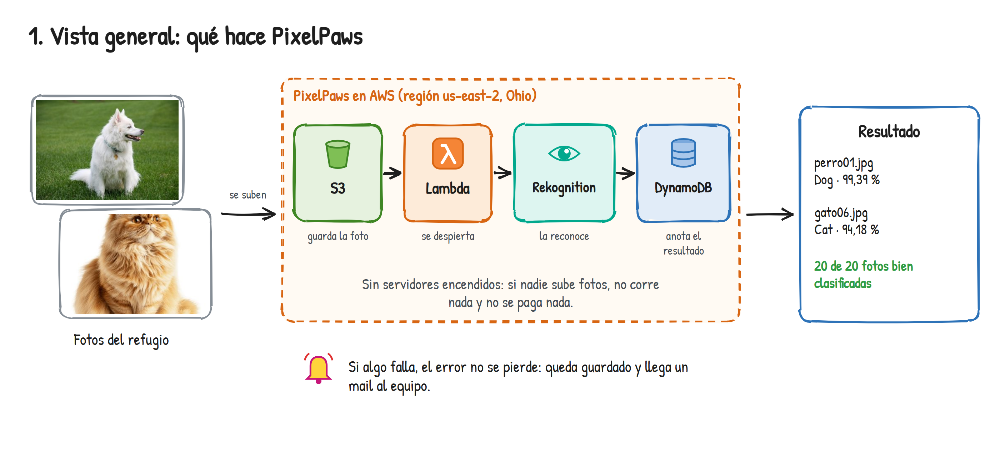

# PixelPaws Pets

Clasificador automático de fotos de mascotas en AWS, sin servidores. Proyecto integrador de
Cloud Computing, Universidad Católica del Uruguay, campus PDE, 2026.

**Equipo:** Enzo Aparicio y Gustavo Gonzalez.

Una foto subida a `uploads/` en S3 dispara una función Lambda, que le pide las etiquetas a
Amazon Rekognition y guarda archivo, etiqueta, confianza y fecha en DynamoDB. Si la función
falla, el evento termina en una cola de errores (SQS) y una alarma de CloudWatch avisa por
correo.



| | |
|---|---|
| **Resultado del lote de prueba** | 20 de 20 fotos clasificadas correctamente, confianza mínima 94,18 % |
| **Latencia por foto** | 240 a 480 ms |
| **Costo real del proyecto** | USD 0,0021 |
| **Proyección a 100.000 fotos por mes** | USD 105, de los cuales 95 % es Rekognition |
| **Análisis de seguridad** | Checkov: 57 controles en verde, 0 fallos, 15 excepciones justificadas |

---

## Por dónde empezar

| Si querés... | Leé |
|---|---|
| Entender el proyecto completo | [`docs/informe.md`](docs/informe.md), 16 secciones con diagramas y el porqué de cada decisión |
| Desplegarlo desde cero | [`docs/runbook.md`](docs/runbook.md), paso a paso, unos 40 minutos |
| Ver la arquitectura | [`docs/arquitectura.md`](docs/arquitectura.md), tres diagramas y lo que dejan decidido |
| Revisar la seguridad | [`docs/seguridad.md`](docs/seguridad.md): matriz IAM, autenticación del pipeline y hallazgos de Checkov |
| Ver los costos | [`docs/FinOps - estimacion y proyeccion PixelPaws.md`](docs/FinOps%20-%20estimacion%20y%20proyeccion%20PixelPaws.md) |
| Saber cómo se usó la IA | [`docs/ia.md`](docs/ia.md): herramientas, prompts, lineamientos y qué salió mal |
| Ver la presentación de la defensa | [`presentacion/`](presentacion/) |

## Arquitectura

| Pieza | Servicio | Qué hace |
|---|---|---|
| Entrada | **Amazon S3** | Bucket privado. Solo el prefijo `uploads/` dispara el proceso |
| Disparador | **Notificación de S3** | Evento `ObjectCreated` filtrado por prefijo, invocación asincrónica |
| Cómputo | **AWS Lambda** | Python 3.12 sobre arm64, 256 MB, 30 s |
| Clasificación | **Amazon Rekognition** | `DetectLabels` con confianza mínima de 70 y hasta 10 etiquetas |
| Catálogo | **Amazon DynamoDB** | Bajo demanda. Guarda `{archivo, etiqueta, confianza, fecha}` |
| Errores | **Amazon SQS** | Cola de mensajes fallidos, retención de 4 días |
| Alerta | **CloudWatch + SNS** | Alarma sobre mensajes en la cola, notificación por correo |
| Costos | **AWS Budgets** | Tope de USD 10 al mes, avisos al 50, 80 y 100 % |

Dos decisiones que suelen generar preguntas:

- **La cola de errores no va en el disparador**, va en `aws_lambda_function_event_invoke_config`
  con `on_failure`, porque S3 invoca de forma asincrónica. El razonamiento completo está en el
  informe.
- **La función verifica en DynamoDB antes de llamar a Rekognition.** Si el archivo ya está
  clasificado, no vuelve a pagar la llamada. Es una medida de ahorro, no una optimización
  prematura: Rekognition es el 95 % del costo proyectado.

## Estructura

```
.
├── bootstrap/bootstrap.sh     # bucket del estado y rol del pipeline, una sola vez
├── lambda/clasificador.py     # la función clasificadora
├── terraform/                 # raíz + 6 módulos
│   └── modules/               # almacenamiento, catalogo, clasificador,
│                              # observabilidad, finops, cicd_oidc
├── scripts/
│   ├── lote.sh                # sube el lote de 20 fotos y muestra los resultados
│   └── credenciales-ci.sh     # respaldo: credenciales temporales si no hay OIDC
├── pruebas/lote/              # las 20 fotos de prueba
├── docs/                      # informe, runbook, arquitectura, seguridad, FinOps, IA
│   ├── diagramas/             # 11 diagramas, con sus editables de Excalidraw
│   └── evidencias/            # salida del lote y checklist de evidencias
├── presentacion/              # la presentación usada en la defensa
└── .github/workflows/         # ci (en PR), apply (en merge), destroy (manual)
```

## Desplegar

El procedimiento completo, con verificaciones y resolución de problemas, está en
[`docs/runbook.md`](docs/runbook.md). La versión corta:

Requiere Terraform 1.17 y el AWS CLI autenticado. Todo va a `us-east-2`.

```bash
# 1. Estado remoto y rol del pipeline, una sola vez
bash bootstrap/bootstrap.sh
#    copiar el nombre del bucket que imprime en terraform/backend.hcl

# 2. Datos que no están en el repositorio, porque es público
export TF_VAR_emails_alerta='["mail-1@ejemplo.com","mail-2@ejemplo.com"]'

# 3. Aplicar
terraform -chdir=terraform init -backend-config=backend.hcl
terraform -chdir=terraform apply
```

Después del primer apply quedan dos pasos manuales que son fáciles de olvidar y que el runbook
explica: **confirmar las suscripciones de correo** (sin eso la alarma no avisa a nadie) y
**activar la etiqueta de costos** en Billing (sin eso el presupuesto marca USD 0).

La notificación de S3 tarda entre 3 y 6 minutos en propagarse después del primer apply. Las
fotos subidas antes de eso no disparan nada.

## Validar

```bash
export BUCKET="$(terraform -chdir=terraform output -raw bucket)"
export TABLA="$(terraform -chdir=terraform output -raw tabla)"
bash scripts/lote.sh
```

Sube las 20 fotos, espera la clasificación y muestra la tabla de resultados. Para probar el
camino de error, el runbook explica cómo disparar la cola de errores y la alarma a propósito.

## El pipeline

| Flujo | Cuándo | Qué hace |
|---|---|---|
| `ci` | En cada pull request | `fmt`, `validate`, `tflint`, Checkov y el `plan` como comentario |
| `apply` | Al mergear a `main` | `apply` con aprobación manual del entorno `production` |
| `destroy` | Manual | Destruye todo y deja evidencia de que la cuenta quedó limpia |

**Cómo entra GitHub a AWS: OIDC.** No hay ninguna clave de AWS guardada en GitHub. Cada
ejecución le pide a GitHub un token de identidad firmado, se lo presenta a AWS STS y recibe
credenciales que **viven una hora y mueren solas**. La política de confianza del rol exige que
el token venga de este repositorio y esté emitido para STS, así que ningún otro repositorio
puede asumirlo.

El rol que se asume no tiene `AdministratorAccess`: lleva siete políticas acotadas a los
servicios del proyecto. El único secret es `AWS_ROLE_ARN`, y un ARN no es un secreto.

Para cuentas donde no se pueda crear el proveedor OIDC, como el Learner Lab, queda el camino de
respaldo: `enable_oidc = false` y credenciales temporales con `scripts/credenciales-ci.sh`. El
detalle está en
[`docs/seguridad.md`](docs/seguridad.md) y en
[`docs/Decision 01`](docs/Decision%2001%20-%20cuenta%20AWS%20Academy%20y%20brechas%20de%20la%20consigna.md).

## Destruir

```bash
terraform -chdir=terraform destroy
```

O el flujo manual `destroy` en GitHub, que pide la aprobación del entorno `production`.

Quedan fuera del estado de Terraform, porque son anteriores a él: el bucket del estado (se borra
desde la consola de S3 con **Empty** y después **Delete**, porque tiene versionado y
`aws s3 rb --force` no alcanza) y, si se usó el camino de respaldo, el rol `pixelpaws-ci`. El runbook
tiene los comandos.
