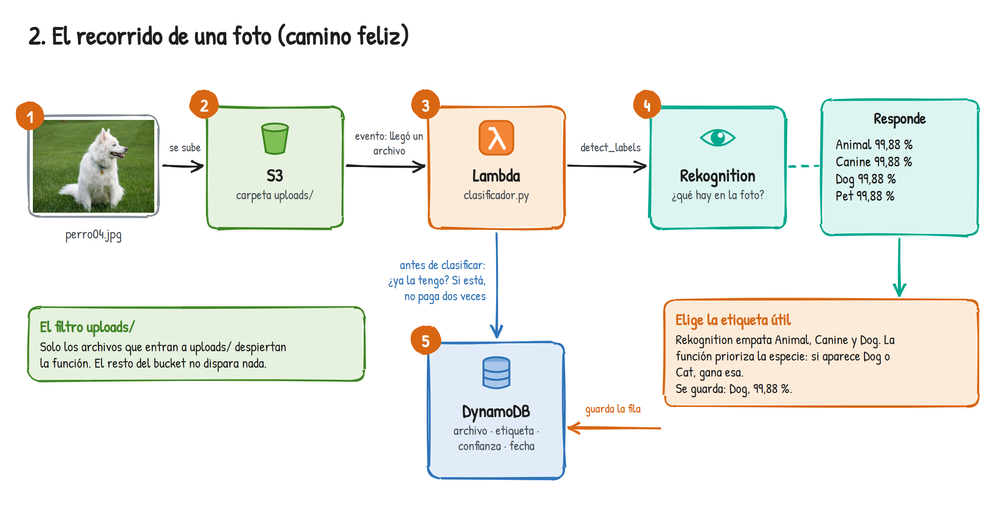
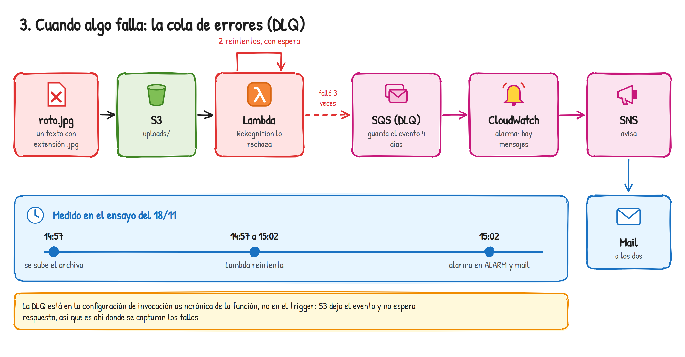
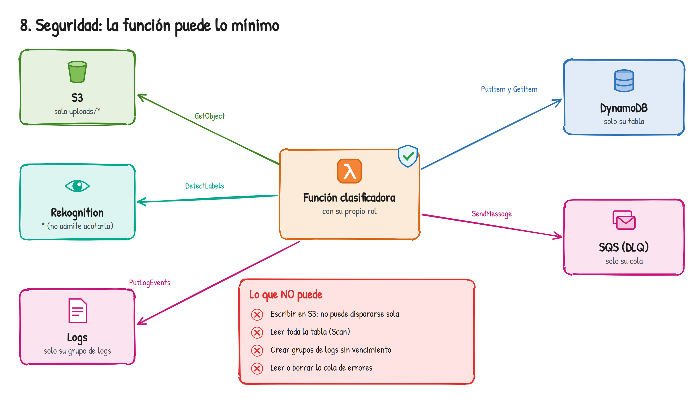
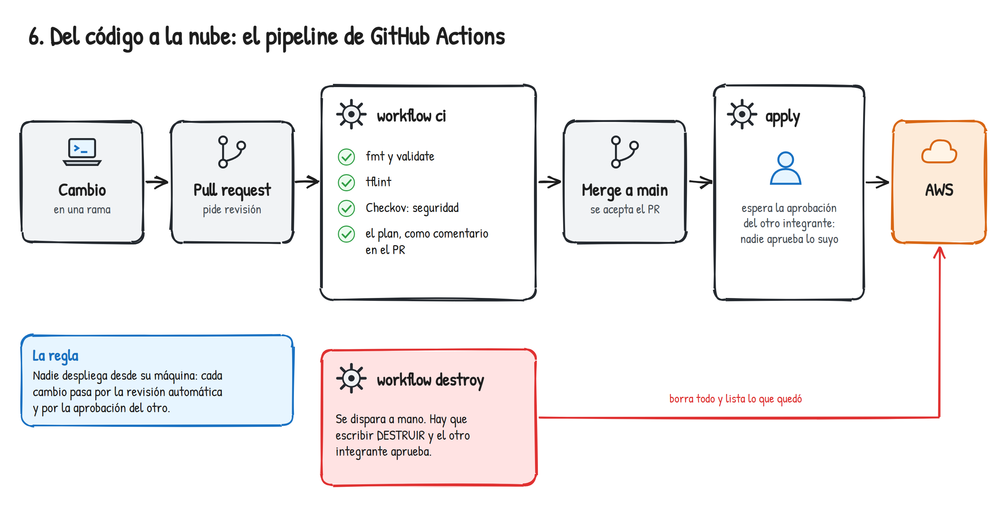

# Arquitectura de PixelPaws

Tres diagramas y lo que cada uno deja decidido. Para el recorrido completo del proyecto, con
las 16 secciones y el resto de los diagramas, está el [informe](informe.md).

---

## 1. El camino del dato, y qué pasa cuando falla

El camino feliz son cinco saltos: una foto llega a `uploads/` en S3, la notificación del bucket
invoca la función, la función le pide las etiquetas a Rekognition y escribe el resultado en
DynamoDB.

El interesante es el otro: **un fallo no se pierde en silencio**, recorre reintentos, cola de
errores, alarma y correo.

Si la función falla, Lambda reintenta dos veces por su cuenta. Agotados los reintentos, el
evento va a una cola SQS, una alarma de CloudWatch la vigila y SNS manda el correo. Entre la
subida del archivo roto y el correo pasan unos cinco minutos.

**Tres detalles que no se ven en el dibujo:**

- Solo las fotos bajo `uploads/` disparan la función. El filtro de prefijo decide qué se
  clasifica, y una foto en la raíz del bucket no dispara nada.
- La función consulta `GetItem` **antes** de llamar a Rekognition. Si el archivo ya está
  clasificado, no vuelve a pagar la llamada. A escala es la única medida de ahorro que mueve la
  aguja: el 95 % del costo es Rekognition.
- La tabla guarda exactamente lo que pide la consigna: `archivo`, `etiqueta`, `confianza` y
  `fecha`. Nada más.

---

## 2. Un permiso por recurso, y el único que no se pudo acotar

La función tiene cinco permisos. Cuatro apuntan a un recurso concreto, uno incluso a un prefijo
dentro del bucket. El quinto apunta a todo, y se sabe exactamente por qué.

| Permiso | Recurso | Por qué |
|---|---|---|
| `s3:GetObject` | `bucket/uploads/*` | Solo el prefijo de entrada, no el bucket entero |
| `rekognition:DetectLabels` | `*` | La operación no expone ARN de recurso: IAM no permite acotarla |
| `dynamodb:PutItem`, `GetItem` | la tabla | Sin `Scan` ni `Query` |
| `sqs:SendMessage` | la cola de errores | Solo enviar: no puede leer ni borrar |
| `logs:CreateLogStream`, `PutLogEvents` | el log group de la función | Sin `CreateLogGroup` |

**Dos ausencias dicen tanto como los permisos presentes.** No está `CreateLogGroup` porque el
grupo lo crea Terraform con retención de 7 días; si lo creara la función, quedaría sin
expiración y generando costo. Y no están `Scan` ni `Query` sobre la tabla, porque la función
nunca lee listados: la consulta del lote de 20 fotos la hace una persona desde la CLI, con otra
identidad.

---

## 3. Tres disparadores, y ninguna clave permanente

El pipeline entra a AWS con **OIDC**: cada ejecución pide su propio token y recibe credenciales
que viven una hora. En GitHub no hay guardada ninguna clave de AWS, solo el ARN del rol.

| Flujo | Cuándo | Qué hace |
|---|---|---|
| `ci` | En cada pull request | `fmt`, `validate`, `tflint`, Checkov y el `plan` como comentario |
| `apply` | Al mergear a `main` | `apply` con aprobación del entorno `production` |
| `destroy` | Manual | Destruye todo y deja evidencia de que la cuenta quedó limpia |

Los tres entran igual. GitHub firma un token que dice qué repositorio, qué rama y qué flujo lo
pidieron; AWS lo valida contra el proveedor OIDC y comprueba dos condiciones de la política de
confianza: que el token sea para `sts.amazonaws.com` y que venga de este repositorio. Recién ahí
entrega credenciales, que duran una hora.

El rol **no tiene `AdministratorAccess`**: lleva siete políticas acotadas a los servicios del
proyecto. El único secret es `AWS_ROLE_ARN`, y un ARN no es un secreto: sin un token válido del
repositorio autorizado, no sirve de nada.

El detalle completo está en [seguridad.md](seguridad.md).

---

## Lo que estos diagramas dejan decidido

Tres cosas que no se ven en un diagrama genérico de "bucket, función, tabla" y que son las que
hacen que esto funcione en el primer apply.

### La cola de errores no va en el disparador

S3 invoca a Lambda de forma asincrónica, así que la cola de errores se declara en la
configuración de invocación (`aws_lambda_function_event_invoke_config`, `on_failure`), no en el
bloque del disparador. Puesta en el lugar equivocado no captura nada y el fallo se pierde sin
rastro.

### El aviso al bucket depende del permiso

S3 valida que puede invocar la función antes de guardar la notificación, y la función necesita
el nombre del bucket. Es una dependencia circular que Terraform no deduce: sin declararla a
mano, el primer apply falla.

### Ningún recurso cobra por hora

Sin balanceador, sin NAT, sin base gestionada, sin clúster. Si nadie sube fotos, el costo es
cero. A escala, el 95 % del gasto es Rekognition, y por eso la función consulta la tabla antes
de clasificar.

---

## Equivalencias si el proyecto se mudara de proveedor

| Pieza | AWS (elegido) | Azure | Google Cloud |
|---|---|---|---|
| Objetos | S3 | Blob Storage | Cloud Storage |
| Evento de subida | Notification del bucket | Event Grid | Eventarc |
| Función | Lambda | Azure Functions | Cloud Run functions |
| Visión preentrenada | Rekognition | AI Vision | Vision API |
| Tabla NoSQL | DynamoDB | Cosmos DB | Firestore |
| Cola de errores | SQS | Contenedor de dead-letter | Pub/Sub |
| Identidad del pipeline | Rol IAM asumido por OIDC (STS) | Federación de credenciales de workload | Federación de identidades de workload |

---

## El resto de la infraestructura

Terraform modular con seis módulos, estado remoto en S3 con bloqueo nativo, etiquetas `project`,
`team`, `env` y `owner` en todo recurso que las admita, y un presupuesto de USD 10 con avisos al
50, 80 y 100 %.

El costo medido de todo el desarrollo fue de **USD 0,0021**. La proyección a 100.000 fotos por
mes es de **USD 105**, de los cuales el 95 % es la API de visión. El desglose está en
[FinOps](FinOps%20-%20estimacion%20y%20proyeccion%20PixelPaws.md).
