# Informe final: PixelPaws Pets

**Clasificación automática de fotos de mascotas con IA, 100% serverless, en AWS con Terraform**

| | |
|---|---|
| **Materia** | Cloud Computing, Universidad Católica del Uruguay, campus PDE, 2026 |
| **Proyecto** | 3. PixelPaws Pets (consigna, página 12) |
| **Equipo** | Enzo Aparicio y Gustavo Gonzalez |
| **Repositorio** | [EnzoAparicio/pixel_paws_Enzo_Gustavo](https://github.com/EnzoAparicio/pixel_paws_Enzo_Gustavo) |
| **Defensa** | Miércoles 25/11/2026 |

> **Cómo leer este informe.** Cada sección explica una parte del sistema con un diagrama, las
> decisiones que tomamos y **por qué**, y un espacio marcado con 📸 para la evidencia. Las
> evidencias pendientes dicen ⏳ y el nombre exacto del archivo que hay que guardar en
> [`evidencias/`](evidencias/). La lista completa está en el [Anexo A](#anexo-a-checklist-de-evidencias).

---

## Índice

1. [Resumen](#1-resumen)
2. [El problema y lo que pide la consigna](#2-el-problema-y-lo-que-pide-la-consigna)
3. [Vista general](#3-vista-general)
4. [El recorrido de una foto](#4-el-recorrido-de-una-foto)
5. [Cuando algo falla](#5-cuando-algo-falla)
6. [Decisiones de diseño y por qué](#6-decisiones-de-diseño-y-por-qué)
7. [La cuenta de AWS y su techo](#7-la-cuenta-de-aws-y-su-techo)
8. [Infraestructura como código](#8-infraestructura-como-código)
9. [CI/CD: del código a la nube](#9-cicd-del-código-a-la-nube)
10. [Seguridad e IAM](#10-seguridad-e-iam)
11. [Observabilidad](#11-observabilidad)
12. [FinOps](#12-finops)
13. [Resultados: el lote de 20 fotos](#13-resultados-el-lote-de-20-fotos)
14. [Destroy y limpieza](#14-destroy-y-limpieza)
15. [Equivalencias con otras nubes](#15-equivalencias-con-otras-nubes)
16. [Limitaciones y qué haríamos distinto](#16-limitaciones-y-qué-haríamos-distinto)
17. [Anexos](#anexos): evidencias, glosario y cómo editar los diagramas

---

## 1. Resumen

Un refugio necesita saber, sin intervención humana, si cada foto que recibe es de un perro o de
un gato. Construimos un sistema que hace eso **por eventos y sin servidores**: la foto entra a un
bucket, una función la clasifica con un servicio de visión preentrenado y el resultado queda en
una tabla. Si algo falla, el error no se pierde y avisa por mail.

Toda la infraestructura está escrita en **Terraform**, se despliega con un **pipeline de GitHub
Actions** y se destruye con un comando.

| Dato | Valor |
|---|---|
| Fotos del lote bien clasificadas | **20 de 20** (10 perros, 10 gatos) |
| Confianza más baja del lote | **94,18 %** (`gato06`) |
| Recursos creados por Terraform | **23** en el primer `apply` |
| Segundo `plan` sin cambios | **0 cambios** (idempotente) |
| Costo real al 18/11 | **USD 0,0021**, cubierto por créditos |
| Costo proyectado con 100.000 fotos por mes | **USD 105 por mes**, el 95 % es Rekognition |
| Tiempo de clasificación de una foto | **579 ms** |
| Tiempo desde un error hasta el mail | **5 minutos** (medido) |

---

## 2. El problema y lo que pide la consigna

La consigna propone una arquitectura de referencia y pide implementarla con foco en la
infraestructura, no en el software: *"el foco está en la infraestructura, no en el desarrollo de
software"*. Esta tabla muestra cada requisito y dónde se cumple.

| La consigna pide | Dónde está | Sección |
|---|---|---|
| Foto, bucket, función, API de visión, tabla NoSQL `{archivo, etiqueta, confianza, fecha}` | S3, Lambda, Rekognition, DynamoDB | [4](#4-el-recorrido-de-una-foto) |
| Cola de mensajes fallidos y alarma | SQS como DLQ, alarma de CloudWatch, SNS | [5](#5-cuando-algo-falla) |
| Diagrama con flujo de datos y límites de seguridad | Los 11 diagramas de este informe | todas |
| Terraform modular, state remoto, versiones fijadas, etiquetas | 6 módulos, estado en S3 con bloqueo | [8](#8-infraestructura-como-código) |
| CI/CD: plan en PR, apply controlado, destroy manual | 3 workflows de GitHub Actions | [9](#9-cicd-del-código-a-la-nube) |
| Menor privilegio y matriz IAM justificada | Rol propio de la función | [10](#10-seguridad-e-iam) |
| Dashboard y una alerta funcionando | Dashboard de 4 gráficos y alarma de la DLQ | [11](#11-observabilidad) |
| Costo real y proyección, presupuesto USD 10 | Nota FinOps y presupuesto con avisos | [12](#12-finops) |
| Lote de 20 fotos clasificado y consulta | `scripts/lote.sh` | [13](#13-resultados-el-lote-de-20-fotos) |
| Evidencia del destroy | Workflow `destroy` | [14](#14-destroy-y-limpieza) |

---

## 3. Vista general

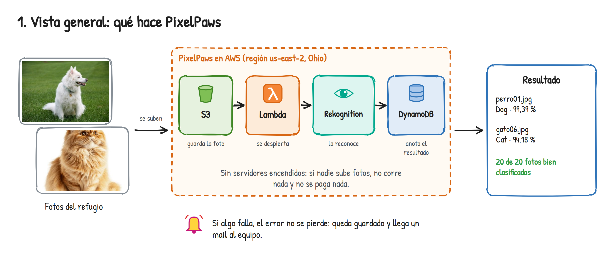

**Qué muestra.** A la izquierda, las fotos del refugio. En el centro, las cuatro piezas que las
procesan, todas dentro de la región de Ohio. A la derecha, la tabla con el resultado. Abajo, la
idea central de la parte de errores: si algo falla, nada se pierde en silencio.

**La idea que lo ordena todo:** no hay ningún servidor encendido. Cada pieza se activa solo cuando
llega una foto, así que si nadie sube fotos el sistema no consume ni cuesta nada.

---

## 4. El recorrido de una foto

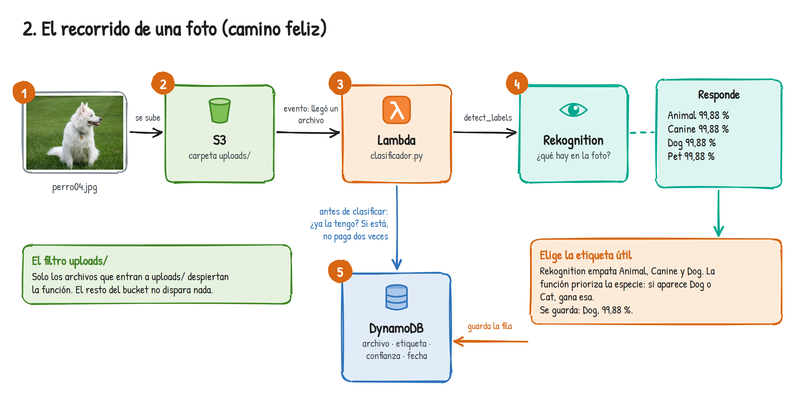

| Paso | Qué pasa | Por qué así |
|---|---|---|
| **1. Se sube la foto** | Alguien deja la foto en la carpeta `uploads/` del bucket `pixelpaws-dev-fotos-ca1889` | S3 es almacenamiento de objetos: se paga por GB guardado y no hay discos que administrar |
| **2. S3 avisa** | S3 genera un evento `ObjectCreated` y despierta la función. Solo para archivos que empiezan con `uploads/` | El filtro decide qué se clasifica. S3 no tiene carpetas reales: `uploads/` es el comienzo del nombre |
| **3. La función se fija si ya la conoce** | Consulta la tabla por el nombre del archivo. Si ya está, termina ahí | Es la medida de ahorro principal: a escala, el 95 % del costo es Rekognition |
| **4. Rekognition mira la foto** | Devuelve etiquetas con su confianza. Pedimos hasta 10, solo por encima del 70 % | Debajo del 70 % las etiquetas son ruido |
| **5. Se elige la etiqueta y se guarda** | Se guarda `archivo, etiqueta, confianza, fecha`, los cuatro campos de la consigna | Ver el recuadro "Elige la etiqueta útil" |

### Un problema real que encontramos

Rekognition devuelve etiquetas **jerárquicas con la misma confianza**: para un perro, `Animal`,
`Canine`, `Dog`, `Mammal` y `Pet`, todas al 99,88 %. Si se guarda la de mayor confianza, el empate
deja **`Animal`** en todas las fotos, que no le sirve a nadie.

**Decisión:** la función prioriza la especie. Si una etiqueta, o uno de sus alias, es `Dog` o
`Cat`, gana esa con su propia confianza. Si aparecen las dos, gana la más segura. Si no hay
especie, queda la de mayor confianza. Lo descubrimos al correr el primer lote real, no lo
supusimos.

> 📸 **Evidencia E06: una foto clasificada en la tabla de DynamoDB**
> Archivo: `evidencias/e06-dynamodb-items.png` · Estado: ⏳ pendiente
> <!--  -->

---

## 5. Cuando algo falla

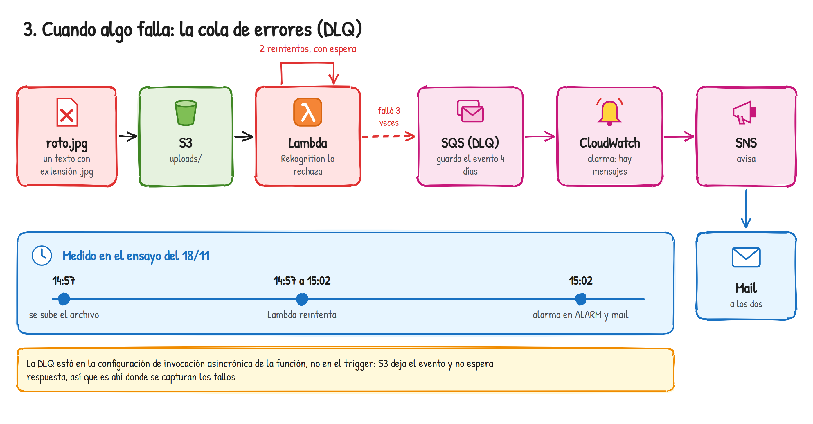

**Qué pasa** cuando llega algo que no es una imagen, por ejemplo un texto con extensión `.jpg`:

1. Rekognition lo rechaza con `InvalidImageFormatException`.
2. La función **relanza el error a propósito**. Si lo atrapara, Lambda creería que salió bien y el
   caso se perdería.
3. Lambda reintenta **2 veces**, con espera entre intentos.
4. Después de 3 intentos fallidos, el evento va a la cola **SQS `pixelpaws-dev-dlq`**, donde queda
   guardado 4 días para reprocesarlo.
5. La alarma de CloudWatch ve un mensaje en la cola, pasa a **ALARM** y **SNS** manda un mail a
   los dos integrantes.

### La decisión que más se pregunta: dónde va la DLQ

S3 invoca a Lambda de forma **asincrónica**: deja el evento y no espera respuesta. En ese modo,
los fallos se capturan en la **configuración de invocación asincrónica** de la función
(`aws_lambda_function_event_invoke_config`, destino `on_failure`), **no** en el trigger. Puesta en
otro lugar, la cola no recibiría nada.

### Medido, no supuesto

En el ensayo del 18/11 subimos el archivo roto a las **14:57** y la alarma pasó a ALARM a las
**15:02**: cinco minutos, por los reintentos con espera. Por eso en la demo la DLQ se dispara antes
y en vivo se muestra la alarma ya disparada.

> 📸 **Evidencia E08: la alarma de la DLQ en estado ALARM**
> Archivo: `evidencias/e08-alarma-dlq.png` · Estado: ⏳ pendiente
> <!--  -->

> 📸 **Evidencia E09: el mail que manda SNS**
> Archivo: `evidencias/e09-mail-alarma.png` · Estado: ⏳ pendiente
> <!--  -->

---

## 6. Decisiones de diseño y por qué

Esta es la sección central del informe. Cada fila es una decisión, qué descartamos y la razón.

### Proveedor y cuenta

| Decidimos | En vez de | Por qué |
|---|---|---|
| **AWS** | Google Cloud o Azure | Todos los servicios de la arquitectura de referencia existen en AWS con capa gratuita, y es la nube que más trabajamos en el semestre. Justificación completa en `docs/Decision 01` |
| **Cuenta propia en plan Free** | AWS Academy Learner Lab | Learner Lab no deja crear roles IAM, ni proveedores OIDC, ni presupuestos: perdíamos puntos en Seguridad, CI/CD y FinOps. El plan Free no puede generar cargos: si se acaban los créditos, AWS suspende la cuenta en vez de cobrar |
| **Región `us-east-2` (Ohio)** | Virginia u Oregón | No fue una elección: la organización de la cuenta solo habilita esa región ([sección 7](#7-la-cuenta-de-aws-y-su-techo)). Tiene la misma tarifa que Virginia para todo lo que usamos |

### Arquitectura

| Decidimos | En vez de | Por qué |
|---|---|---|
| **Todo por eventos, sin servidores** | Una VM o un contenedor | Ningún recurso cobra por hora: no hay balanceador, NAT, base relacional ni servidor. Sin fotos, costo cero |
| **Filtro del evento en `uploads/`** | Escuchar todo el bucket | Define qué se clasifica y deja el resto del bucket libre. La función además no puede escribir en S3, así que no puede dispararse a sí misma |
| **Lambda Python 3.12, arm64** | x86 | Graviton cuesta alrededor de 20 % menos por milisegundo y Python corre igual |
| **256 MB y 30 s** | 128 MB | Con 128 MB la espera de red a Rekognition se nota. Medimos 579 ms por foto: 30 s sobran sin dejar colgada una falla |
| **Rekognition `DetectLabels`, confianza mínima 70 %** | Entrenar un modelo propio | La consigna pide IA gestionada. Un modelo propio es trabajo de software, no de infraestructura |
| **DynamoDB on-demand** | Base relacional (RDS) | Una relacional cobra por hora aunque no se use. On-demand cobra por escritura, y el tráfico llega por lotes. No necesitamos joins |
| **Clave primaria = nombre del archivo** | Un id autogenerado | Idempotencia natural: si la misma foto se procesa dos veces, pisa su fila en vez de duplicarla |
| **Consultar la tabla antes de clasificar** | Clasificar siempre | No se paga dos veces a Rekognition por la misma foto. Es la única optimización que mueve el costo |
| **Priorizar Dog o Cat en la etiqueta** | La etiqueta de mayor confianza | El empate de Rekognition dejaba "Animal" en todas las fotos ([sección 4](#un-problema-real-que-encontramos)) |
| **DLQ en la invocación asincrónica, 2 reintentos** | DLQ en el trigger | S3 invoca sin esperar respuesta: es ahí donde se capturan los fallos |
| **Una sola alarma, sobre la DLQ** | Alarmas sobre cada métrica | La consigna pide "alarma sobre la DLQ". Esa alarma prueba que el error quedó guardado, no solo que ocurrió |

### Infraestructura como código y pipeline

| Decidimos | En vez de | Por qué |
|---|---|---|
| **6 módulos por capacidad** | Un solo archivo, o un módulo por servicio | Cada módulo es una parte completa del sistema y tiene un dueño. La misma estructura se puede llevar a otra nube |
| **Estado en S3 con `use_lockfile`** | Tabla de DynamoDB para el bloqueo | Desde Terraform 1.10 el bloqueo es nativo: un recurso menos |
| **Bucket del estado creado con un script** | Que lo cree Terraform | Terraform necesita dónde guardar su estado antes de crear nada. La consigna lo permite como única excepción |
| **Credenciales temporales de 12 horas** | OIDC | OIDC es lo correcto y está escrito, pero la organización de la cuenta bloquea crear el proveedor ([sección 9](#cómo-entra-github-a-aws)) |
| **Repositorio público** | Privado | Los revisores obligatorios de los environments de GitHub, que hacen "controlado" al apply, no existen en repos privados de cuentas gratis. Los mails van en un secret |

### Seguridad y costos

| Decidimos | En vez de | Por qué |
|---|---|---|
| **Cifrado con claves de AWS** | Una clave KMS propia | Cada clave KMS cuesta USD 1 por mes, el 10 % del presupuesto. Todo queda cifrado igual |
| **Función fuera de una VPC** | Lambda dentro de una VPC | Solo usa servicios gestionados. En una VPC necesitaría un NAT Gateway, unos USD 32 por mes |
| **Logs con 7 días de retención** | Retención indefinida | Lo exige la consigna, y un log sin vencimiento genera costo para siempre |
| **Point-in-time recovery apagado** | Encendido | Duplica el costo de almacenamiento y los datos se regeneran reprocesando las fotos |
| **Presupuesto de USD 10 filtrado por etiqueta** | Presupuesto de toda la cuenta | Mide solo este proyecto, gracias a la etiqueta `project` que lleva cada recurso |

---

## 7. La cuenta de AWS y su techo

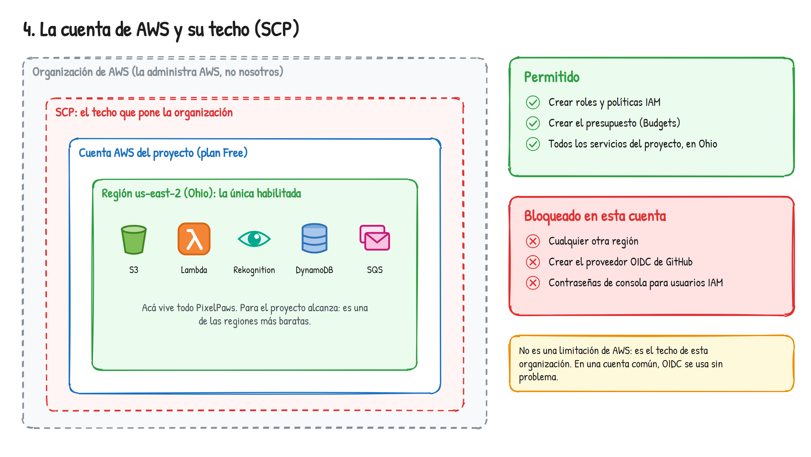

**Qué encontramos.** La cuenta del plan Free no es una cuenta suelta: AWS la ubica dentro de una
**organización que administra AWS**, no nosotros. Esa organización le aplica una **SCP** (*Service
Control Policy*), una política que está por encima de todos los permisos de la cuenta. Aunque un
rol diga "acceso total", lo que la SCP niega queda negado, y no se puede cambiar desde adentro.

**Qué permite y qué no**, según lo que probamos:

| | Resultado |
|---|---|
| Crear roles IAM y políticas | ✅ Permitido |
| Crear el presupuesto (Budgets) | ✅ Permitido |
| Los servicios del proyecto en `us-east-2` | ✅ Permitido |
| Cualquier otra región | ❌ Bloqueado |
| Crear el proveedor OIDC de GitHub | ❌ Bloqueado (ver la evidencia pendiente abajo) |
| Contraseñas de consola para usuarios IAM | ❌ Bloqueado |

**Qué decidimos.** No bajar la seguridad: el pipeline usa credenciales temporales que vencen solas
([sección 9](#cómo-entra-github-a-aws)), y el código de OIDC queda escrito y apagado con una
bandera, listo para una cuenta sin esta restricción.

> **Importante: no es una limitación de AWS.** En AWS se puede usar OIDC con GitHub Actions, y es
> la práctica recomendada. La restricción es de **esta cuenta**, por la organización que la
> administra.

> 📸 **Evidencia E04: el error al crear el proveedor OIDC en la cuenta del proyecto**
> Archivo: `evidencias/e04-oidc-error.png` (y el texto del error, copiado) · Estado: ⏳ **pendiente y bloqueante**
> Es la única prueba de la restricción: AWS no publica el contenido de esa SCP. Se obtiene con
> `aws iam create-open-id-connect-provider --url https://token.actions.githubusercontent.com --client-id-list sts.amazonaws.com`.
> Si el error **no** menciona `explicit deny in a service control policy`, OIDC es usable y hay que
> encenderlo antes de la defensa (el procedimiento está en la guía de defensa, sección 3).
> **Indicio a favor:** el 18/11, en otra cuenta del plan Free creada en aws.amazon.com, la consulta
> `aws iam list-open-id-connect-providers` respondió `explicit deny in a service control policy`.
> <!--  -->

---

## 8. Infraestructura como código

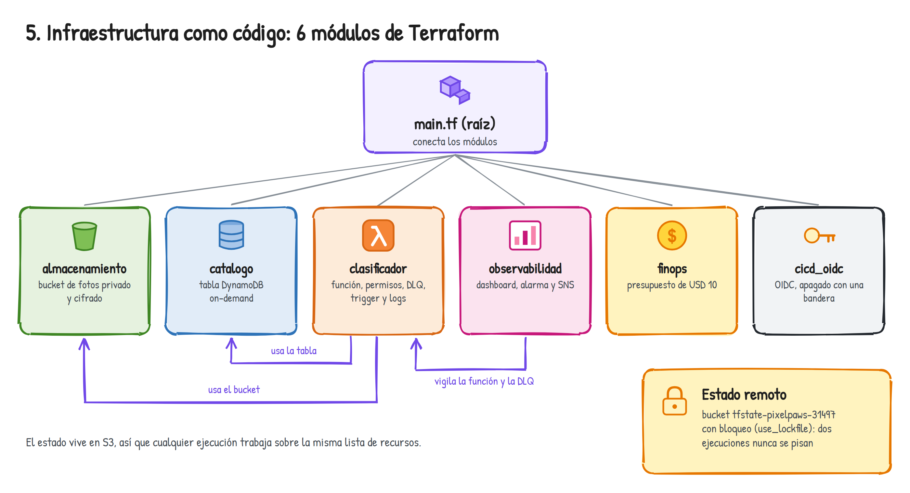

**Cómo está organizado.** El `main.tf` de la raíz no crea recursos sueltos: conecta seis módulos,
cada uno una capacidad completa del sistema. Las flechas violetas muestran qué usa cada módulo de
otro. Por ejemplo, `clasificador` necesita el bucket de `almacenamiento` y la tabla de `catalogo`.

| Módulo | Qué crea | Dueño |
|---|---|---|
| `almacenamiento` | Bucket de fotos: privado, versionado, cifrado | Enzo |
| `catalogo` | Tabla DynamoDB on-demand, clave `archivo` | Gustavo |
| `clasificador` | Función, su rol de menor privilegio, la DLQ, el trigger de S3 y el grupo de logs | Gustavo |
| `observabilidad` | Dashboard, alarma de la DLQ y tópico SNS con los mails | Gustavo |
| `finops` | Presupuesto de USD 10 con tres avisos | Gustavo |
| `cicd_oidc` | Proveedor OIDC y rol de GitHub, detrás de la bandera `enable_oidc` | Enzo |

**Lo que pide la consigna, punto por punto:**

- **Estado remoto con bloqueo:** bucket `tfstate-pixelpaws-31497`, versionado, con
  `use_lockfile = true`. Dos ejecuciones simultáneas no pueden pisarse.
- **Versiones fijadas:** Terraform `~> 1.17` y provider de AWS `~> 6.73`.
- **Etiquetas obligatorias:** `project`, `team`, `env` y `owner` en todos los recursos, con
  `default_tags` del provider: se escriben una vez y se aplican a todo.
- **Variables con descripción, tipo y validación:** por ejemplo, la región solo acepta las tres de
  la franja más barata, el entorno solo `dev` o `prod`, y el presupuesto no puede pasar de USD 10.
- **Banderas para lo opcional:** una sola, `enable_oidc`, apagada por la restricción de la cuenta.
- **Idempotencia, probada:** el primer `apply` creó 23 recursos. Al cambiar solo el código de la
  función, el `apply` cambió **1 recurso**. Un segundo `plan` sin cambios no propone nada.
- **Destroy limpio:** el bucket de fotos tiene `force_destroy`, así se borra aunque tenga fotos.

**Cómo llega el código a la nube.** Terraform comprime `lambda/clasificador.py` en un zip y lo sube
a la función. Guarda una huella del zip (`source_code_hash`), así que solo lo vuelve a subir cuando
el código cambia.

> 📸 **Evidencia E16: un segundo `plan` sin cambios (idempotencia)**
> Archivo: `evidencias/e16-plan-sin-cambios.png` · Estado: ⏳ pendiente
> <!--  -->

---

## 9. CI/CD: del código a la nube

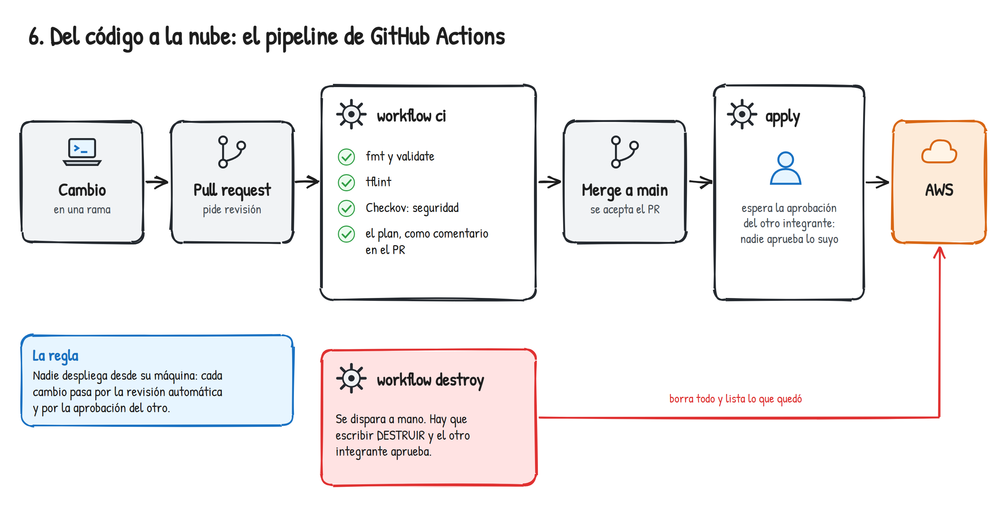

**La regla:** nadie despliega desde su máquina. Todo cambio pasa por tres workflows de GitHub
Actions.

| Workflow | Cuándo corre | Qué hace |
|---|---|---|
| `ci` | En cada pull request | `fmt`, `validate`, `tflint`, Checkov, y publica el `plan` como comentario en el PR |
| `apply` | Al hacer merge a `main` | Espera la aprobación del otro integrante en el environment `production` y aplica |
| `destroy` | A mano | Pide aprobación del entorno `production`, destruye y lista lo que quedó |

**Por qué "controlado":** el environment `production` tiene a los dos integrantes como revisores
y la opción *Prevent self-review*: nadie aprueba su propio despliegue. Además, los workflows de
`apply` y `destroy` comparten un grupo de `concurrency`, así que nunca corren dos a la vez sobre el
mismo estado.

### Cómo entra GitHub a AWS

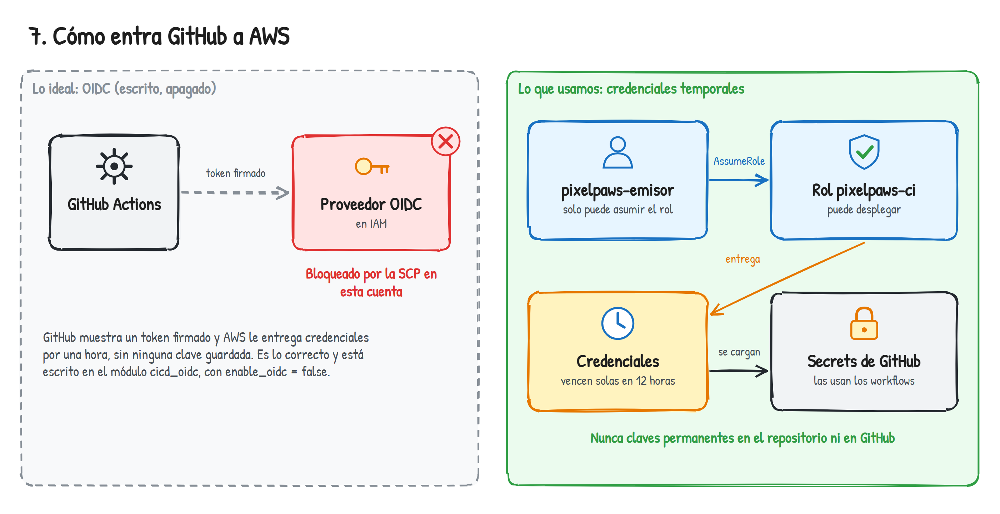

- **Lo ideal (izquierda): OIDC.** GitHub presenta un token firmado y AWS le entrega credenciales
  por una hora, sin ninguna clave guardada. Está escrito en el módulo `cicd_oidc` y se puede ver con
  `terraform plan -var enable_oidc=true`. En esta cuenta, la organización bloquea crear el
  proveedor ([sección 7](#7-la-cuenta-de-aws-y-su-techo)).
- **Lo que usamos (derecha): credenciales temporales.** Un usuario IAM, `pixelpaws-emisor`, cuyo
  único permiso es asumir el rol `pixelpaws-ci`, genera con `scripts/credenciales-ci.sh` tres
  valores que **vencen solos en 12 horas**. Se cargan como secrets en GitHub.

**Por qué esto cumple la consigna:** lo que se prohíbe son las *"credenciales de larga duración"*.
Estas vencen solas: si se filtraran, al día siguiente no sirven. La clave del emisor nunca está en
el repositorio ni en GitHub, y se borra al cerrar el proyecto.

> 📸 **Evidencia E01: el plan publicado como comentario en un pull request**
> Archivo: `evidencias/e01-pr-con-plan.png` · Estado: ⏳ pendiente
> <!--  -->

> 📸 **Evidencia E02: el apply esperando aprobación en `production`**
> Archivo: `evidencias/e02-apply-esperando-aprobacion.png` · Estado: ⏳ pendiente
> <!--  -->

---

## 10. Seguridad e IAM

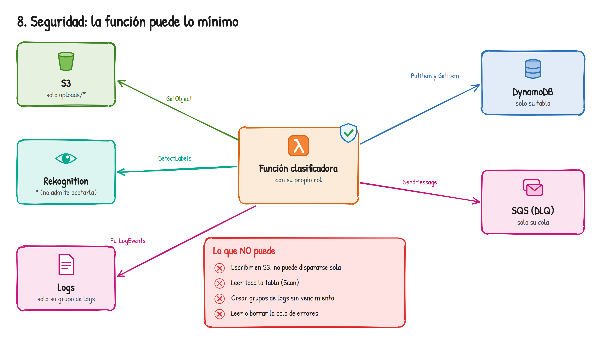

### Matriz IAM de la función

Cada permiso está acotado al recurso mínimo. Es la matriz que pide la consigna, escrita como
código en el módulo `clasificador`.

| Permiso | Sobre qué | Para qué |
|---|---|---|
| `s3:GetObject` | solo `uploads/*` del bucket | Leer la foto que disparó el evento |
| `rekognition:DetectLabels` | `*` | Clasificar. Es **el único sin acotar**: la operación no opera sobre un recurso con ARN, así que IAM no permite restringirla |
| `dynamodb:PutItem`, `GetItem` | solo la tabla | Guardar el resultado y verificar duplicados. Sin `Scan` |
| `sqs:SendMessage` | solo la DLQ | Mandar los fallos. No puede leer ni borrar la cola |
| `logs:CreateLogStream`, `PutLogEvents` | solo su grupo de logs | Escribir logs. Sin `CreateLogGroup`: el grupo lo crea Terraform con 7 días |

**Las ausencias también son decisiones:** sin `s3:PutObject` la función no puede dispararse a sí
misma; sin `Scan` no puede leer la tabla entera; sin `CreateLogGroup` no puede crear un grupo de
logs sin vencimiento.

### Otras identidades

| Identidad | Permisos | Por qué |
|---|---|---|
| Rol `pixelpaws-ci` | `AdministratorAccess` | El pipeline crea roles, políticas y el presupuesto. Solo entrega credenciales de 12 horas como máximo |
| Usuario `pixelpaws-emisor` | solo asumir `pixelpaws-ci` | Genera las credenciales del pipeline. Su clave vive en una sola PC |
| Usuario `gustavo` | `AdministratorAccess` | Acceso por CLI del segundo integrante: la organización bloquea la consola para usuarios IAM |

**Lo que reconocemos.** Las identidades que despliegan tienen `AdministratorAccess`, y eso **no**
es menor privilegio. Es una decisión consciente: quien despliega crea roles y políticas, y en IAM
poder crear roles equivale a tener cualquier permiso. Acotarlo bien requiere *permission
boundaries*, que no entraron en el tiempo del proyecto. Lo que corre en producción, la función, sí
tiene lo mínimo. Los usuarios se borran el 25/11.

### Escaneo con Checkov

Checkov revisa cada pull request: **57 controles pasan, 0 fallan y 15 están aceptados con
justificación escrita** en `docs/seguridad.md`. La mayoría de las excepciones son por costo (una
clave KMS propia cuesta el 10 % del presupuesto) o falsos positivos (Checkov no reconoce la DLQ
cuando está en la configuración asincrónica).

> 📸 **Evidencia E03: resultado de Checkov en el pipeline**
> Archivo: `evidencias/e03-checkov.png` · Estado: ⏳ pendiente
> <!--  -->

> 📸 **Evidencia E15: prueba de menor privilegio** (la función intenta algo que no tiene permitido y AWS lo niega)
> Archivo: `evidencias/e15-menor-privilegio.png` · Estado: ⏳ pendiente
> <!--  -->

---

## 11. Observabilidad

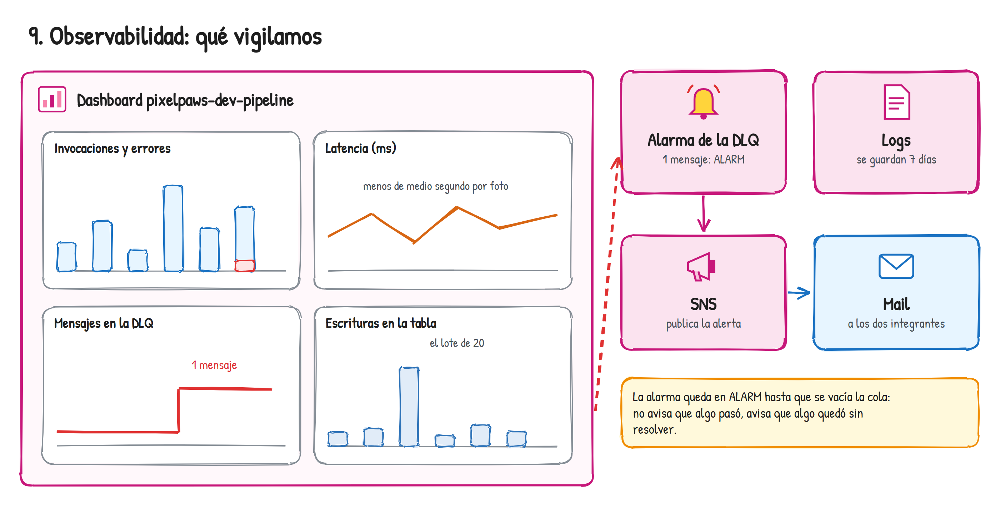

La consigna pide *"métricas de errores y alarma sobre la DLQ"*, y al menos un dashboard y una
alerta funcionando.

| Pieza | Qué vigila |
|---|---|
| **Dashboard `pixelpaws-dev-pipeline`** | Invocaciones y errores de la función, latencia promedio y máxima, mensajes en la DLQ y escrituras en la tabla |
| **Alarma `pixelpaws-dev-dlq-con-mensajes`** | Pasa a ALARM con un solo mensaje en la cola y avisa por SNS |
| **Tópico SNS `pixelpaws-dev-alertas`** | Manda el mail a los dos integrantes |
| **Logs** | Todo lo que registra la función, con 7 días de retención |

**Por qué una alarma sobre la cola y no sobre los errores.** Un error puede resolverse solo en un
reintento. Un mensaje en la DLQ significa que algo **quedó sin resolver**. Por eso la alarma se
queda en ALARM hasta que se vacía la cola.

> 📸 **Evidencia E07: el dashboard con datos reales**
> Archivo: `evidencias/e07-dashboard.png` · Estado: ⏳ pendiente
> <!--  -->

---

## 12. FinOps

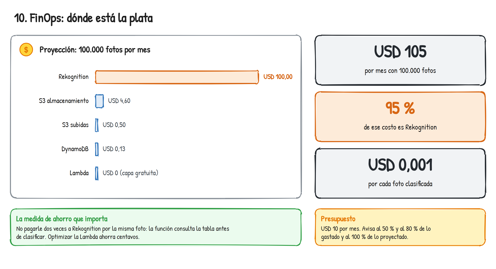

### Costo real contra estimado

| | Valor |
|---|---|
| **Estimado** para todo el proyecto (300 imágenes entre pruebas, lote y demo) | USD 0,32 |
| **Real** al 18/11, según la facturación | USD 0,0021, cubierto por créditos |
| **Real** al cierre | ⏳ completar con la evidencia E10 |

El gasto real es casi cero porque todo es pago por uso y el tráfico de prueba es mínimo. El dato
que importa es la proyección.

### Proyección: 100.000 fotos por mes

| Concepto | Costo mensual | Peso |
|---|---|---|
| Rekognition (USD 0,001 por foto) | USD 100,00 | 95 % |
| S3, almacenamiento | USD 4,60 | 4,4 % |
| S3, subidas | USD 0,50 | 0,5 % |
| DynamoDB, escrituras | USD 0,13 | 0,1 % |
| Lambda | USD 0 (dentro de la capa gratuita) | 0 % |
| **Total** | **USD 105 por mes** | |

**La conclusión:** optimizar la función no mueve la aguja; ahorra centavos. Lo único que ahorra
plata de verdad es **no llamar a Rekognition de más**, y por eso la función consulta la tabla antes
de clasificar.

### Medidas de ahorro aplicadas

| Medida | Efecto |
|---|---|
| Deduplicar antes de clasificar | Evita pagar dos veces la misma foto |
| Nada con costo por hora | Sin NAT, balanceador ni base relacional: costo fijo cero |
| Logs con 7 días | El almacenamiento de logs no crece para siempre |
| Sin claves KMS propias | USD 1 por mes menos por cada servicio cifrado |
| Presupuesto de USD 10 | Avisa al 50 % y 80 % de lo gastado y al 100 % de lo **proyectado**, antes de que pase |

> 📸 **Evidencia E10: costo real en la consola de facturación**
> Archivo: `evidencias/e10-facturacion.png` · Estado: ⏳ pendiente (captura del domingo 22)
> <!--  -->

> 📸 **Evidencia E11: el presupuesto en AWS Budgets**
> Archivo: `evidencias/e11-presupuesto.png` · Estado: ⏳ pendiente
> <!--  -->

> 📸 **Evidencia E12: la proyección en la AWS Pricing Calculator**
> Archivo: `evidencias/e12-calculadora.png` (y el link compartible) · Estado: ⏳ pendiente
> La consigna pide la proyección *"usando la calculadora del proveedor o Infracost"*. Los números
> de arriba salen de los precios oficiales; falta cargarlos en calculator.aws y guardar el link.
> <!--  -->

---

## 13. Resultados: el lote de 20 fotos

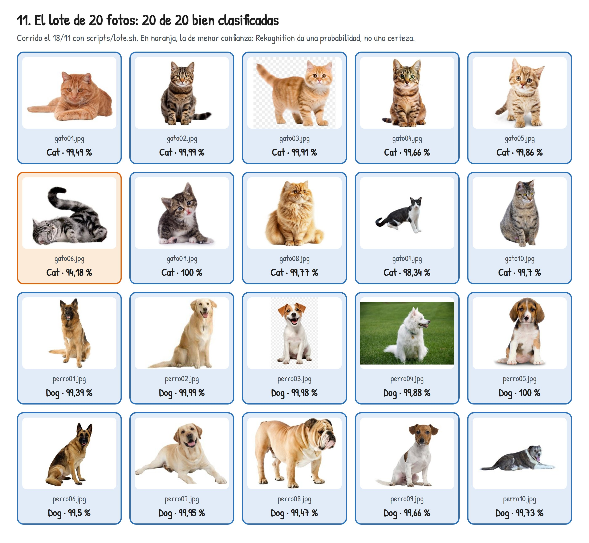

Es el entregable específico de PixelPaws: *"lote de 20 fotos de prueba clasificado y consulta de
resultados"*. El script `scripts/lote.sh` sube las 20 fotos a `uploads/`, espera a que se
clasifiquen y arma la tabla consultando DynamoDB.

| Resultado | Valor |
|---|---|
| Bien clasificadas | **20 de 20**: 10 `Cat` y 10 `Dog` |
| Confianza más baja | 94,18 % (`gato06`, un gato acostado y retorcido, en una pose poco común) |
| Confianza más alta | 100 % (`gato07` y `perro05`) |

**Lo que muestra:** Rekognition devuelve una **probabilidad, no una certeza**. Por eso pedimos solo
etiquetas por encima del 70 %, y por eso la tabla guarda la confianza junto a la etiqueta.

> 📸 **Evidencia E05: salida completa de `lote.sh`** · Estado: ✅ lista
> Archivo: [`../evidencias/lote-20-fotos-2026-11-18.txt`](../evidencias/lote-20-fotos-2026-11-18.txt)

---

## 14. Destroy y limpieza

La consigna pide *"evidencia del destroy"* y, después de la demo, *"captura del estado vacío y de
la facturación del mes"*.

**Cómo se destruye:** con el workflow `destroy`, que pide aprobación del entorno. Su último paso
lista lo que queda en la cuenta con nombre `pixelpaws`: tiene que decir que no queda ninguna
función, tabla ni bucket. El bucket del estado se borra a mano al final (Empty y Delete en la
consola), porque con versionado `aws s3 rb --force` no alcanza.

> 📸 **Evidencia E13: el workflow `destroy` en verde, con "Recursos restantes" vacío**
> Archivo: `evidencias/e13-destroy.png` · Estado: ⏳ pendiente (ensayo del lunes 23 y defensa)
> <!--  -->

> 📸 **Evidencia E14: estado vacío y facturación del mes, después de la defensa**
> Archivos: `evidencias/e14-estado-vacio.png` y `evidencias/e14-facturacion-final.png` · Estado: ⏳ pendiente (25/11)
> <!--  -->

---

## 15. Equivalencias con otras nubes

El diseño no depende de AWS: cada pieza tiene su equivalente, y los módulos están organizados por
capacidad, no por servicio.

| Pieza | AWS (usado) | Google Cloud | Azure |
|---|---|---|---|
| Almacenamiento | S3 | Cloud Storage | Blob Storage |
| Cómputo por evento | Lambda | Cloud Run functions | Azure Functions |
| IA de visión | Rekognition | Vision API | Azure AI Vision |
| Base NoSQL | DynamoDB | Firestore | Cosmos DB |
| Cola de errores | SQS | Pub/Sub dead-letter | Service Bus |
| Métricas y alarmas | CloudWatch | Cloud Monitoring | Azure Monitor |
| Notificaciones | SNS | Pub/Sub | Event Grid |
| Presupuesto | AWS Budgets | Cloud Billing Budgets | Cost Management Budgets |

---

## 16. Limitaciones y qué haríamos distinto

| Limitación | Por qué pasó | Qué haríamos con más tiempo o en otra cuenta |
|---|---|---|
| El pipeline no usa OIDC | La organización de la cuenta bloquea el proveedor | Encender `enable_oidc = true` en una cuenta sin esa restricción. El código ya está |
| Las identidades que despliegan tienen permisos de administrador | Crear roles requiere permisos amplios | Acotarlas con *permission boundaries* |
| Una sola región | La impone la cuenta, y la consigna pide una | Para producción real, evaluar una réplica en otra región |
| Un bucket recién creado tarda de 3 a 6 minutos en avisar | Comportamiento de S3 que medimos al desplegar | Ya se resolvió en el proceso: se despliega el día anterior a la demo, como pide la consigna |
| No hay tests unitarios de la función | Se priorizó lo que pide la consigna: la prueba de punta a punta con el lote | Sumar tests con mocks al workflow `ci` |

---

## Anexos

### Anexo A: checklist de evidencias

Guardar cada captura en [`evidencias/`](evidencias/) con el nombre exacto y, en la sección
correspondiente, borrar `<!--` y `-->` de la línea de la imagen para que se muestre.

| # | Evidencia | Archivo | Sección | Estado |
|---|---|---|---|---|
| E01 | Plan comentado en un PR | `e01-pr-con-plan.png` | [9](#9-cicd-del-código-a-la-nube) | ⏳ |
| E02 | Apply esperando aprobación | `e02-apply-esperando-aprobacion.png` | [9](#9-cicd-del-código-a-la-nube) | ⏳ |
| E03 | Resultado de Checkov | `e03-checkov.png` | [10](#10-seguridad-e-iam) | ⏳ |
| E04 | Error de OIDC en la cuenta | `e04-oidc-error.png` | [7](#7-la-cuenta-de-aws-y-su-techo) | ⏳ **bloqueante** |
| E05 | Salida de `lote.sh` | `../evidencias/lote-20-fotos-2026-11-18.txt` | [13](#13-resultados-el-lote-de-20-fotos) | ✅ |
| E06 | Filas en DynamoDB | `e06-dynamodb-items.png` | [4](#4-el-recorrido-de-una-foto) | ⏳ |
| E07 | Dashboard con datos | `e07-dashboard.png` | [11](#11-observabilidad) | ⏳ |
| E08 | Alarma de la DLQ en ALARM | `e08-alarma-dlq.png` | [5](#5-cuando-algo-falla) | ⏳ |
| E09 | Mail de la alarma | `e09-mail-alarma.png` | [5](#5-cuando-algo-falla) | ⏳ |
| E10 | Facturación: costo real | `e10-facturacion.png` | [12](#12-finops) | ⏳ |
| E11 | Presupuesto en Budgets | `e11-presupuesto.png` | [12](#12-finops) | ⏳ |
| E12 | Proyección en la calculadora | `e12-calculadora.png` | [12](#12-finops) | ⏳ |
| E13 | Workflow destroy en verde | `e13-destroy.png` | [14](#14-destroy-y-limpieza) | ⏳ |
| E14 | Estado vacío y facturación final | `e14-estado-vacio.png`, `e14-facturacion-final.png` | [14](#14-destroy-y-limpieza) | ⏳ |
| E15 | Prueba de menor privilegio | `e15-menor-privilegio.png` | [10](#10-seguridad-e-iam) | ⏳ |
| E16 | Segundo plan sin cambios | `e16-plan-sin-cambios.png` | [8](#8-infraestructura-como-código) | ⏳ |

### Anexo B: glosario

| Término | Qué es, en una línea |
|---|---|
| **Serverless** | No hay servidores encendidos: el código corre solo cuando llega un evento |
| **Evento asincrónico** | Quien avisa no espera la respuesta. Así invoca S3 a Lambda |
| **DLQ** | *Dead-letter queue*: la cola donde quedan los eventos que fallaron todos sus intentos |
| **Idempotencia** | Aplicar dos veces lo mismo da el mismo resultado: la segunda vez no cambia nada |
| **Estado de Terraform** | La lista de lo que Terraform creó. Vive en S3, con bloqueo |
| **SCP** | Política de una organización de AWS que pone un techo a los permisos de sus cuentas |
| **OIDC** | Forma de que GitHub entre a AWS con un token firmado, sin claves guardadas |
| **Menor privilegio** | Cada identidad tiene solo los permisos que necesita, sobre los recursos que necesita |

### Anexo C: los diagramas

Los once diagramas están en [`diagramas/`](diagramas/) como imagen, y los diez de arquitectura
también como archivo editable de Excalidraw en
[`diagramas/excalidraw/`](diagramas/excalidraw/).

**Para editar uno:** entrar a [excalidraw.com](https://excalidraw.com), menú → **Abrir**, y elegir el
`.excalidraw`. Íconos y fotos ya vienen adentro del archivo. Para volver a exportar: menú →
**Exportar imagen** → PNG.

| # | Diagrama | Sección |
|---|---|---|
| 1 | [Vista general](diagramas/01-vista-general.png) | [3](#3-vista-general) |
| 2 | [El recorrido de una foto](diagramas/02-recorrido-de-una-foto.png) | [4](#4-el-recorrido-de-una-foto) |
| 3 | [El camino de error](diagramas/03-camino-de-error.png) | [5](#5-cuando-algo-falla) |
| 4 | [La cuenta y la SCP](diagramas/04-la-cuenta-y-la-scp.png) | [7](#7-la-cuenta-de-aws-y-su-techo) |
| 5 | [Los 6 módulos de Terraform](diagramas/05-terraform-modulos.png) | [8](#8-infraestructura-como-código) |
| 6 | [El pipeline](diagramas/06-pipeline.png) | [9](#9-cicd-del-código-a-la-nube) |
| 7 | [Cómo entra GitHub a AWS](diagramas/07-credenciales-del-pipeline.png) | [9](#cómo-entra-github-a-aws) |
| 8 | [Permisos de la función](diagramas/08-permisos-de-la-funcion.png) | [10](#10-seguridad-e-iam) |
| 9 | [Observabilidad](diagramas/09-observabilidad.png) | [11](#11-observabilidad) |
| 10 | [Costos](diagramas/10-costos.png) | [12](#12-finops) |
| 11 | [Lote de 20 fotos](diagramas/11-lote-20-fotos.jpg) | [13](#13-resultados-el-lote-de-20-fotos) |
